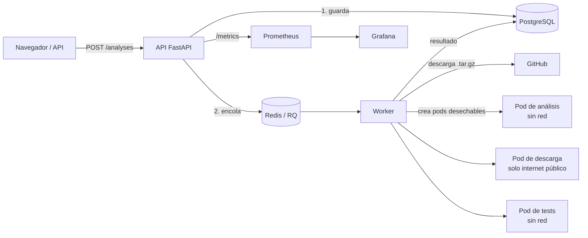

# deadcode-service

Servicio que analiza repositorios públicos de Python y detecta **código
muerto** (funciones que nadie usa), combinando análisis estático (Vulture)
con la cobertura de los tests del propio repo (coverage.py).

Proyecto de aprendizaje y portafolio: una aplicación real llevada de punta
a punta por contenedores, CI/CD, Kubernetes, GitOps, observabilidad y nube
con Terraform, ejecutando código de terceros de forma aislada y segura.

---

## Infraestructura

### Arquitectura



- **API (FastAPI)** + página web propia (sin frameworks de frontend).
- **PostgreSQL** como fuente de verdad y **Redis + RQ** como cola.
- **Worker** que nunca ejecuta ni lee código ajeno: se lo entrega a pods
  desechables por stdin y recibe JSON por stdout.

### Entornos

| Entorno | Qué corre | Cómo se despliega |
|---|---|---|
| **Docker Compose** | API, worker, Postgres 17, Redis 8 y un proxy que limita el acceso al socket de Docker | `docker compose up` |
| **Kubernetes local (kind)** | Chart de Helm propio: API (2 réplicas), worker, Postgres (StatefulSet con disco), Redis, sandboxes | ArgoCD (GitOps) |
| **AWS (EKS + RDS)** | El mismo chart con un archivo de valores para la nube: base de datos administrada (RDS) y nodos aparte para los sandboxes | Terraform + ArgoCD |

### CI/CD y GitOps

```
git push → CI (tests, build de imagen, chart de Helm, reglas de alerta)
        → imagen en GHCR con etiqueta inmutable sha-<commit>
        → commit automático con la nueva etiqueta
        → ArgoCD detecta el cambio y lo aplica al clúster
```

- **GitHub Actions** con 5 jobs: ~350 tests (contra Postgres y Redis
  reales), build de la imagen, validación del chart para kind y para AWS,
  pruebas de las alertas con `promtool`, publicación y despliegue.
- **GHCR**: la imagen se publica solo si todo pasa, y solo desde `main`.
- **ArgoCD** con *self-heal* y *prune*: si alguien cambia algo a mano en
  el clúster, vuelve a lo que dice git. Volver atrás = `git revert`.
- Nadie ejecuta `kubectl` ni `helm` para desplegar.

### Observabilidad

- **Prometheus + Grafana** (kube-prometheus-stack) instalados con ArgoCD.
- **Métricas propias**: peticiones y latencia por ruta, cola de trabajos,
  análisis por estado, fallos por motivo, duración por nivel y resultados
  del cruce. Se leen de Postgres y Redis (la fuente de verdad), no del
  worker.
- **Dashboard en git**, generado desde un script de Python.
- **5 alertas** con tests automáticos: API caída, fuente de métricas
  caída, worker atascado, sandbox huérfano y disco de Postgres casi lleno.

### Nube (AWS con Terraform)

- **Bootstrap**: un bucket S3 cifrado y versionado para el estado de
  Terraform, protegido contra borrado. Es la única pieza permanente.
- **Plataforma**, que se crea y se destruye en cada sesión:
  - **VPC** en 2 zonas, subredes públicas y privadas, NAT gateway.
  - **EKS** (Kubernetes 1.37 en soporte estándar) con la API accesible
    solo desde una IP, NetworkPolicy activada y dos grupos de nodos:
    *general* y *sandbox* (con *taint*, límite de procesos y sin acceso a
    las credenciales del nodo).
  - **RDS Postgres 17**: sin IP pública, cifrado, SSL obligatorio; la
    contraseña la genera AWS y vive en Secrets Manager (nunca en el
    código ni en el estado de Terraform).
- **Dos scripts**: encender todo (~14 min, de cero a la app funcionando)
  y apagar todo (~8 min, comprobando que no quede nada cobrando). Una
  sesión de prueba completa costó ~0,35 USD, con un presupuesto mensual
  de 10 USD con alertas.

### Seguridad: ejecutar código de terceros

El análisis con tests ejecuta código de repos ajenos, así que el
aislamiento fue la parte central del diseño:

| Riesgo | Defensa |
|---|---|
| URLs maliciosas (SSRF) | Lista blanca: solo `https://github.com/<dueño>/<repo>`; redirecciones solo a GitHub |
| Bombas de descompresión | Límites de tamaño y de cantidad de archivos; extracción segura |
| Salir a la red | NetworkPolicy *deny-all* + un **"portero"** que no deja arrancar el pod hasta comprobar que no hay red (al nacer, cada pod tiene ~1 s de red abierta; medido en kind y en EKS) |
| Dependencias trampa | Solo paquetes precompilados de PyPI, sin URLs directas; el pod de descarga ve internet pero no la red interna |
| Escalar privilegios | Pod Security *restricted*, usuario sin privilegios, disco de solo lectura, sin token de Kubernetes |
| Bomba de procesos | Máximo 128 procesos por pod en los nodos de sandbox (probado: frena en 128) |
| Robar credenciales de la nube | Los pods no pueden pedir las credenciales del nodo (IMDSv2, *hop limit* 1) |
| XSS en la página | Los nombres vienen de repos ajenos: se insertan solo como texto + cabecera CSP |

---

## Análisis y resultados

### Qué hace el análisis

1. **Nivel 1 (estático):** Vulture busca definiciones que nadie nombra.
   Cada hallazgo se clasifica con reglas propias (prioridad, ubicación,
   motivo) y reglas por framework (FastAPI, Flask, Django, Pydantic,
   pytest).
2. **Nivel 2 (con tests):** se descargan las dependencias del repo, se
   corren sus propios tests con coverage.py y se cruzan los resultados:
   si los tests ejecutaron algo que Vulture marcó, es un falso positivo
   demostrado.

### Qué se obtuvo

Se analizaron 21 librerías públicas de Python (requests, werkzeug, click,
packaging, sqlparse, tqdm, entre otras). De 13 se obtuvieron 168
hallazgos que se pudieron juzgar con los tests, y después se revisaron a
mano, buscando cada nombre en todo el repo:

| | Hallazgos |
|---|---|
| Juzgados con los tests | 168 |
| Los tests **sí** los ejecutaron (vivos) | 76 |
| Los tests **nunca** los ejecutaron | 92 |
| … vivos según la revisión manual | 68 |
| … dudosos (API pública para otros proyectos) | 20 |
| … **muertos de verdad** | **4** |

**Conclusiones:**

- En librerías maduras, **~97% de lo que marca el análisis estático no es
  código muerto**. Lo llama Python de forma automática (`__dir__`,
  `__eq__`, `writelines`), un framework externo (callbacks), un nombre
  armado en texto (`getattr`) o es API pública.
- La prioridad "alta" de Vulture acertó solo entre un 4% y un 8% de las
  veces.
- "Los tests nunca lo ejecutaron" no prueba que esté muerto: casi siempre
  es código vivo sin tests. Por eso la app no lo presenta como
  "confirmado".
- Lo fiable del cruce es lo contrario: si los tests lo ejecutaron, está
  vivo.
- **La herramienta sirve como lista de candidatos para revisar a mano, no
  como veredicto automático.**

---

## Cómo correrlo

Requisitos: Docker Desktop, uv y Python 3.12.

**Local con Docker Compose** (nivel 1):

```bash
cp .env.example .env          # y cambia la contraseña
docker compose up -d --build
# página: http://127.0.0.1:8000/   API: http://127.0.0.1:8000/docs
```

**Tests** (con Compose arriba; usan una base de datos aparte):

```bash
uv sync
uv run pytest
```

**Kubernetes local** (kind + ArgoCD, niveles 1 y 2):

```bash
kind create cluster --config k8s/kind-config.yaml
kubectl create namespace deadcode
kubectl create secret generic postgres-credentials -n deadcode \
  --from-literal=POSTGRES_USER=deadcode --from-literal=POSTGRES_DB=deadcode \
  --from-literal=POSTGRES_PASSWORD=<una-contraseña>
kubectl create namespace argocd
kubectl apply -n argocd --server-side --force-conflicts \
  -f https://raw.githubusercontent.com/argoproj/argo-cd/v3.6.1/manifests/install.yaml
kubectl apply -f argocd/deadcode.yaml   # desde aquí, desplegar = git push
# página: http://127.0.0.1:8080/
```

**AWS** (tiene costo: se destruye al terminar cada sesión):

```powershell
aws login --profile deadcode
.\scripts\eks-up.ps1      # crea todo y despliega la app
.\scripts\eks-down.ps1    # destruye todo y verifica que nada quede cobrando
```

## Estructura

```
src/deadcode_service/   API, worker, sandbox, analizadores y página web
tests/                  tests (pytest) y tests de las alertas (promtool)
charts/deadcode-service chart de Helm (valores para kind y para AWS)
argocd/                 aplicaciones de ArgoCD (kind y EKS)
monitoring/             valores de Prometheus y Grafana
infra/aws/              Terraform (estado + plataforma)
scripts/                encender/apagar AWS y generar el dashboard
```

## Lecciones aprendidas

- **Medir antes de fijar límites:** Grafana con poca memoria saturó el
  disco y tumbó la API de Kubernetes del clúster local.
- **Las NetworkPolicy no son instantáneas:** un pod nuevo tiene ~1 s de
  red antes de que se apliquen, en kind y en EKS.
- **Las contraseñas no van dentro de una URL de conexión:** la que genera
  AWS puede traer símbolos que la rompen.
- **Medir con datos revisados a mano:** sin esa revisión, el análisis
  parecía mucho más preciso de lo que es.

## Licencia

MIT
